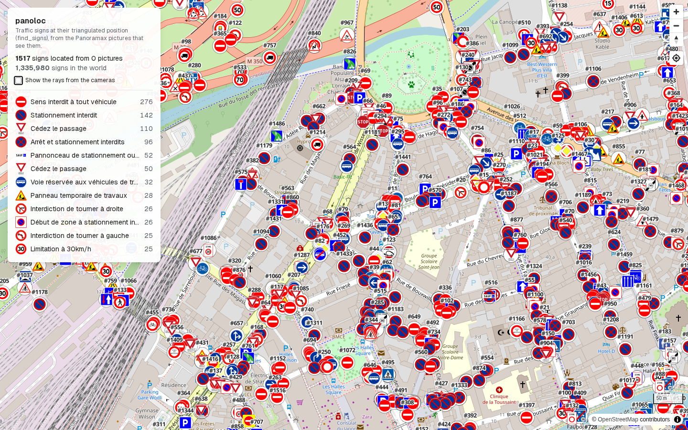
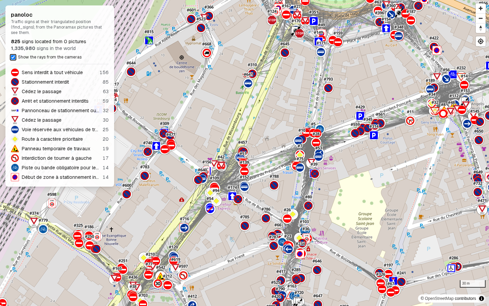
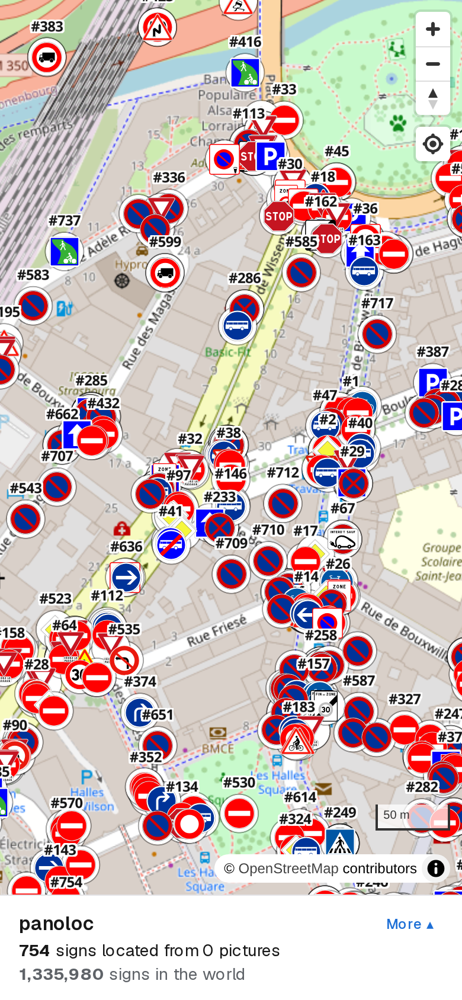
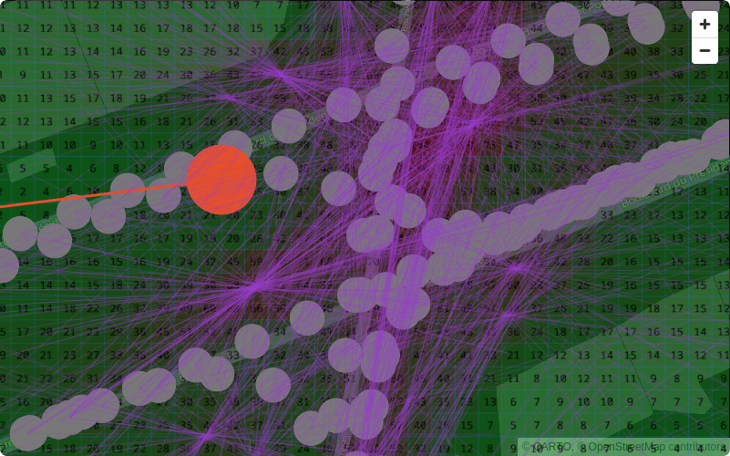
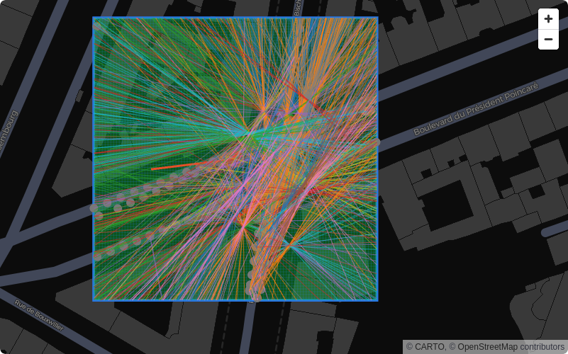
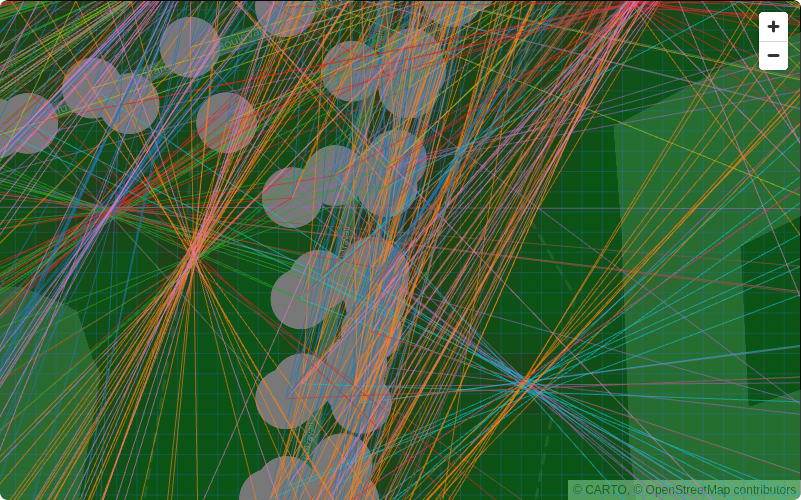
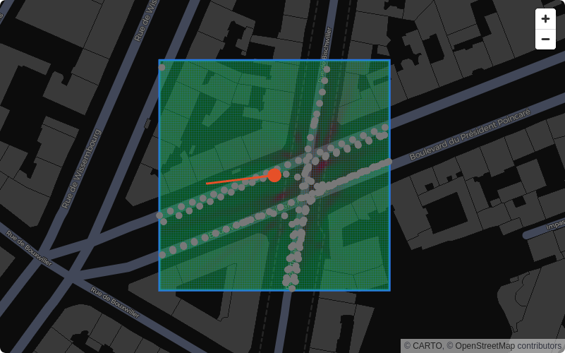
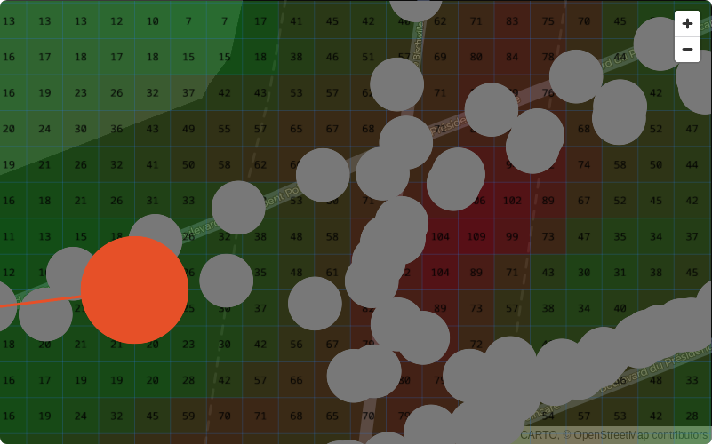
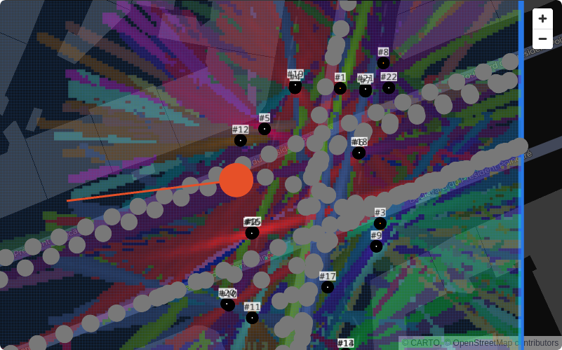

# Panoloc

Precisely geolocate the objects detected in [Panoramax](https://panoramax.fr) pictures, beyond the approximate position where each picture was taken.

**Live demo: [panoloc.jdecorte.com](https://panoloc.jdecorte.com/)**



| Rays from the cameras | Mobile |
| --- | --- |
|  |  |

> Mirror of [codeberg.org/PierreBorine/panoloc](https://codeberg.org/PierreBorine/panoloc), where development happens.

## Context

panoloc was built during the **Digital Commons Week** hackathon, organised with **Free** and **Scaleway**. Our team worked on [Panoramax](https://panoramax.fr), the open street-level imagery project from the OpenStreetMap community: its pictures already come with automatic traffic sign detections, but each detection is only placed where the picture was taken, not where the sign actually stands. panoloc fixes that by combining the detections of several pictures to locate each sign on the map.

## Approach

1. **Extract**: fetch the pictures of a sequence and their metadata from the Panoramax API.
2. **Rays**: combine the position of each detected object in the image with the camera's coordinates and orientation to trace an oriented half-line in the world.
3. **Locate**, with two methods benchmarked against each other:
   - *Triangulation*: intersect the rays of the same sign seen from several pictures.
   - *Monocular depth*: estimate the distance along a single ray with a depth model ([Depth Pro](https://github.com/apple-aiml-research/ml-depth-pro)).
4. **Evaluate**: measure the error in meters against a reference position.

## How signs are located

Panoramax detections are turned into sign positions with a ray-voting heat map:

| | |
| --- | --- |
| **1. Rays**<br>Turn each sign box into a line from the camera towards the sign, with an estimated distance. |  |
| **2. Group**<br>Split rays by sign type and facing direction. |  |
| **3. Vote**<br>Each ray adds points to the 1 m cells it crosses, near its estimated distance. |  |
| **4. Grid**<br>The resulting heat map of scores. |  |
| **5. Blur**<br>Smooth the grid to absorb GPS and compass noise. |  |
| **6. Find peaks**<br>Keep the highest cells with enough votes; each one is a candidate sign. |  |

7. **Rays near**: collect the rays pointing at each peak, at most one per photo.
8. **Least squares point**: compute the exact position where those rays cross.
9. **Sign**: save the sign with its type, position, facing, and the photos that saw it.

## Requirements

- [uv](https://docs.astral.sh/uv/)
- Docker (MongoDB)
- Node.js and [pnpm](https://pnpm.io/) (web map only)

## Usage

### Streamlit app

```sh
make install
make run
```

Click **LOAD** to fetch the metadata of the requested pictures from the Panoramax API. Check **Download pictures** in the sidebar to also download the HD pictures. Files are stored in `data/raw/<sequence_id>/<picture_id>.{jpg,json}`.

Query the metadata with the DuckDB CLI:

```sql
SELECT * FROM read_json('data/raw/*/*.json');
```

### Web map

A Next.js map of the traffic signs detected in Panoramax pictures, read from MongoDB:

```sh
make populate                      # load the detections into MongoDB
make web-install
cp web/.env.example web/.env.local
make web-dev                       # http://localhost:3000
```

See [web/README.md](web/README.md) for details. Run `make help` for all available commands.

## Dependencies

| Package | Used for |
| --- | --- |
| `requests` | HTTP calls to the Panoramax API and picture downloads |
| `streamlit` | Local web app, written in plain Python |
| `pydeck` | App map: camera positions and headings |
| `pillow` | Opening pictures and drawing annotation bounding boxes |
| `depth-pro` | Monocular metric depth estimation |
| `scipy` | Triangulation |
| `pymongo` | MongoDB storage for detections and located signs |
| `tqdm` | Progress bars for long-running jobs |
| `watchdog` | Reloading the app when a file is saved |

## Resources

- [maxspeed-map](https://source.cipherbliss.com/tykayn/maxspeed-map): deduplication of Panoramax sign detections
- [Strasbourg traffic signs](https://data.strasbourg.eu/explore/dataset/signalisation_verticale/table/): reference positions
- [Depth Pro](https://github.com/apple-aiml-research/ml-depth-pro): monocular metric depth and focal length estimation
- [Krylov et al. 2018](https://arxiv.org/abs/1708.08417): geotagging objects from street view imagery, combining depth and triangulation

## History

Pull requests merged on [Codeberg](https://codeberg.org/PierreBorine/panoloc/pulls?state=closed):

| PR | Title | Author |
| --- | --- | --- |
| [#19](https://codeberg.org/PierreBorine/panoloc/pulls/19) | docs(depth): add note for future | PierreBorine |
| [#18](https://codeberg.org/PierreBorine/panoloc/pulls/18) | feat/nextjs-frontend | jdecorte |
| [#17](https://codeberg.org/PierreBorine/panoloc/pulls/17) | feat(depth): return coordinates instead of relative distances | PierreBorine |
| [#16](https://codeberg.org/PierreBorine/panoloc/pulls/16) | refactor/minor-fixes | Lykoro |
| [#15](https://codeberg.org/PierreBorine/panoloc/pulls/15) | feat/sign-grouping | jdecorte |
| [#14](https://codeberg.org/PierreBorine/panoloc/pulls/14) | feat: add depth estimation | PierreBorine |
| [#13](https://codeberg.org/PierreBorine/panoloc/pulls/13) | feat(panoloc): add an attribute for ray distance | Lykoro |
| [#12](https://codeberg.org/PierreBorine/panoloc/pulls/12) | fix(streamlit): disable telemetry | Lykoro |
| [#11](https://codeberg.org/PierreBorine/panoloc/pulls/11) | test(triangulation): improve display for triangulate_many tests | Lykoro |
| [#10](https://codeberg.org/PierreBorine/panoloc/pulls/10) | feat/heatmap-deduplication | jdecorte |
| [#9](https://codeberg.org/PierreBorine/panoloc/pulls/9) | feat: add triangulation algorithm | Lykoro |
| [#8](https://codeberg.org/PierreBorine/panoloc/pulls/8) | feat: cache pictures and metadata on disk in data/raw | perigoose |
| [#7](https://codeberg.org/PierreBorine/panoloc/pulls/7) | fix-previous-pr | perigoose |
| [#5](https://codeberg.org/PierreBorine/panoloc/pulls/5) | chore: add all base commiters to license copyrights | PierreBorine |
| [#4](https://codeberg.org/PierreBorine/panoloc/pulls/4) | feat(frontend): live Panoramax fetch, map and 360° view with annotations | jdecorte |
| [#3](https://codeberg.org/PierreBorine/panoloc/pulls/3) | Add fetch script and streamlit app | perigoose |
| [#2](https://codeberg.org/PierreBorine/panoloc/pulls/2) | feat(dataset): get dataset in a bbox radius of 10, sort them by timestamp | jdecorte |
| [#1](https://codeberg.org/PierreBorine/panoloc/pulls/1) | Init python project with uv | perigoose |

## License

[MIT](LICENSE)
